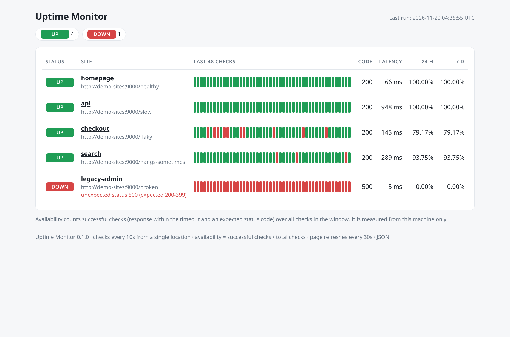
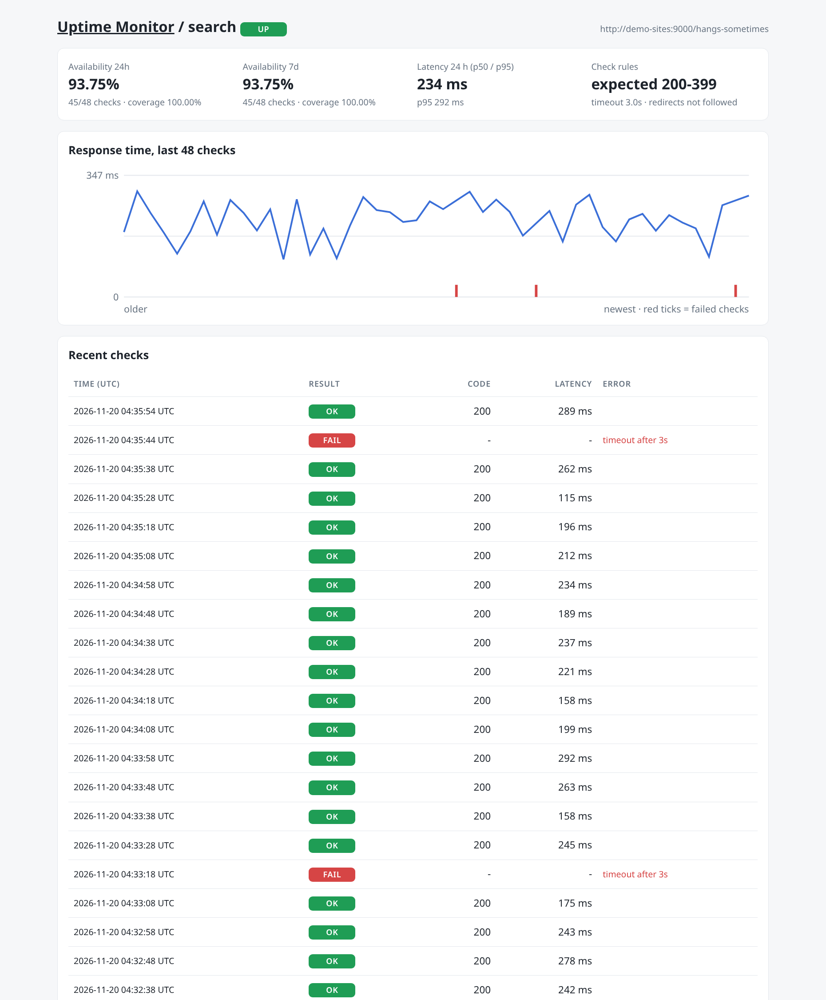
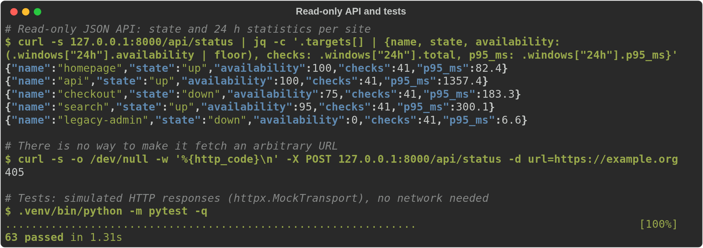

# Uptime Monitor

[](https://github.com/lucianorichard/uptime-monitor/actions/workflows/ci.yml)


A small, self-hosted availability monitor for **your own websites**. It checks a list of URLs
on a fixed interval, records the HTTP status, response time and errors in SQLite, and shows
the current state and recent history on a local dashboard.

It is deliberately simple: one process, no accounts, no external notifications, and no way
for anyone using the dashboard to make it request an arbitrary URL.

## Video Demonstration

Watch the monitor track simulated HTTP services, display availability
and latency, detect failures, recover, and expose its JSON API.

[](https://youtu.be/XNT0YLR93nY?si=EXNzaX35FHU7Mq89)

*Demonstration uses simulated local services.*

## Features

- **Periodic checks** of a configured list of URLs, concurrently, on a drift-free schedule.
- **Records** status code, response time and the error (timeout, DNS/TCP/TLS failure,
  unexpected status) of every check.
- **Explicit availability maths** (below), per site, over the last 24 hours and 7 days, with
  **coverage** so monitoring gaps are visible.
- **Dashboard** with current state (UP, DOWN, STALE, NO DATA), the last 60 checks as a status
  bar, latency, and a per-site page with a latency chart and check history. Server-rendered
  HTML and SVG, no JavaScript.
- **Read-only JSON API** for scripts.
- **Timeouts** per target plus a hard wall-clock limit per check.
- **Docker** image running as a non-root user, published on `127.0.0.1` only.

## Quick start

### Docker

```bash
git clone https://github.com/lucianorichard/uptime-monitor.git
cd uptime-monitor
cp examples/config.example.toml config.toml   # then list your own sites
docker compose up -d --build
open http://127.0.0.1:8000                    # or xdg-open
```

Try it without touching any real site: the demo adds a container with simulated healthy,
slow, flaky, hanging and broken endpoints.

```bash
docker compose -f compose.yaml -f compose.demo.yaml up -d --build
```

### Without Docker

```bash
python3 -m venv .venv && . .venv/bin/activate
pip install .
cp examples/config.example.toml config.toml
uptime-monitor --config config.toml          # http://127.0.0.1:8000
```

## Configuration

Targets come **only** from a local TOML file that you manage. See
[`examples/config.example.toml`](examples/config.example.toml):

```toml
[monitor]
interval_seconds = 60      # one check per target per interval (10 to 86400)
timeout_seconds = 10       # default per-target timeout; must be shorter than the interval
retention_days = 30        # older results are deleted
database = "data/uptime.db"

[[targets]]
name = "website"
url = "https://www.example.com/"

[[targets]]
name = "api-health"
url = "https://api.example.com/health"
expected_status = 200      # only 200 counts as up (default "200-399")
timeout_seconds = 5

[[targets]]
name = "blog"
url = "https://example.com/blog"
expected_status = ["200-299", 301]
follow_redirects = false   # default: the redirect itself is the result
```

The file is validated on start-up: only `http`/`https` URLs with a host, no credentials
embedded in URLs (they would end up in the database and the dashboard), unique names,
timeouts shorter than the interval, and no unknown keys. An invalid file stops the program
with a clear message.

## How availability is calculated

A **check** is one `GET` request to a target.

- A check is **successful** when a response arrives within the timeout **and** its status
  code is in the target's expected set (default `200-399`).
- Anything else is a **failed** check: timeout, DNS, TCP or TLS error, connection reset, or
  an unexpected status code (e.g. `500`, or `302` when only `200` is expected).

```
availability(window) = successful checks / total checks in the window x 100
```

- Every check has the **same weight**; there is no interpolation between checks.
- A window with no checks shows **no data**, never 100%.
- Response time is measured until the response **headers** arrive (it includes DNS, TCP,
  TLS and server processing). The body is not downloaded.
- Latency is summarised as p50 and p95 using the nearest-rank method, so each value is an
  actually observed response time.

Because the measurement is sampled, two more numbers keep it honest:

```
coverage(window) = checks performed / checks expected (window / interval) x 100
```

Expected checks are counted from the first stored check of a target when that is more
recent than the start of the window, so a newly added site is not reported as poorly covered.
Coverage below 100% means the monitor itself was not running for part of the window. Those
periods are **not** counted as downtime or as uptime; they are simply unknown. A site whose
last check is older than three intervals is shown as **STALE**, not UP.

The definition lives in one small, tested module:
[`availability.py`](src/uptime_monitor/availability.py).

## Screenshots

**Site detail: availability, coverage, latency percentiles, chart and recent checks**



**Read-only JSON API and tests with simulated HTTP responses**



## Security model

- **No arbitrary destinations.** The list of URLs comes only from the configuration file.
  The web interface and API have only `GET` routes, none of them takes a URL or host
  parameter, and site names in URLs must match a configured target (otherwise `404`). A test
  enumerates every route to enforce this.
- **Redirects are not followed** by default, so a redirect cannot steer the monitor to a
  destination that is not in your configuration. Enable `follow_redirects` per target if you
  want the final page checked.
- **Local only.** The dashboard has no authentication, so it binds to `127.0.0.1` by default
  and Docker publishes it on `127.0.0.1` only. Put it behind a reverse proxy with
  authentication before exposing it anywhere else.
- **Output is escaped.** Error messages and anything else that originates from monitored
  servers is HTML-escaped by Jinja2; responses carry a strict Content-Security-Policy,
  `X-Frame-Options: DENY` and `nosniff`.
- The container runs as an unprivileged user and mounts the configuration read-only.

## Limitations of a single monitoring location

This tool checks your sites **from one place**: the machine it runs on. That has real
consequences for what its numbers mean:

- **It measures reachability from here, not for your users.** A DNS problem, routing issue,
  CDN edge failure or regional outage can make a site unreachable for users elsewhere while
  it looks fine from this location, and the reverse.
- **The monitor's own network is part of every measurement.** If its Wi-Fi, ISP or DNS
  resolver fails, every site looks down at once. A sudden "everything is down" usually
  means the monitor is the problem; a single-location monitor cannot tell the difference.
- **No consensus.** Multi-location services confirm an outage from several vantage points
  before declaring it, which filters out transient network blips. Here, one failed check
  is one failure.
- **Latency is local.** Response times include the path from this machine; they are not
  representative of users on other networks or continents.
- **If the monitor is down, nothing is measured.** Coverage and the STALE state make that
  visible, but no alert is sent.
- **Sampling.** Outages shorter than the interval can be missed entirely.

To mitigate: run a second instance on a different network and compare, keep the interval
short relative to the outages you care about, and treat this as a sanity check rather than a
service-level measurement.

## API

All read-only:

| Endpoint | Description |
| --- | --- |
| `GET /` | Dashboard |
| `GET /targets/{name}` | Site detail page |
| `GET /api/status` | Current state and 24 h / 7 d statistics for every target |
| `GET /api/targets/{name}/checks?limit=100` | Most recent checks (1 to 1000) |
| `GET /healthz` | Liveness and time of the last monitoring run |
| `GET /api/docs` | OpenAPI documentation |

## Project layout

```text
src/uptime_monitor/
  config.py        TOML loading and strict validation (the only source of URLs)
  checker.py       one HTTP check: timeouts, latency, classification
  availability.py  the availability, coverage and percentile definitions
  storage.py       SQLite (stdlib sqlite3, WAL, retention)
  monitor.py       periodic task, concurrent checks, drift-free schedule
  app.py           FastAPI routes, dashboard data, security headers
  templates/       Jinja2 HTML (dashboard, site detail)
examples/          example and demo configurations, simulated demo sites
tests/             63 tests with simulated HTTP responses (httpx.MockTransport)
```

## Technical decisions

- **httpx `MockTransport` for tests.** Every network situation (200, 503, redirects,
  connection refused, read timeout, a server that hangs) is simulated in-process, so the
  suite is fast, deterministic and needs no network.
- **Two timeouts.** httpx timeouts apply per phase (connect, read, ...); a server that sends
  a byte every few seconds would never trigger them. `asyncio.wait_for` adds a hard
  wall-clock limit per check.
- **Headers-only timing.** Measuring until headers arrive reflects responsiveness and avoids
  downloading large pages every minute.
- **Drift-free scheduling.** The next run is planned from the previous start time on a
  monotonic clock; if a cycle overruns, missed slots are skipped instead of bursting.
- **One failing cycle does not stop monitoring**, and is logged.
- **SQLite with the standard library.** A single table with an index on
  `(target, checked_at)`, WAL mode so the dashboard can read while the monitor writes, and
  daily retention pruning. No ORM is needed for four queries.
- **Server-rendered SVG** charts: no JavaScript or third-party front-end assets, which also
  allows a strict Content-Security-Policy.

## Out of scope (for now)

No notifications (email, chat, webhooks), user accounts, multi-location checks, TLS
certificate expiry checks or keyword matching. The checker and storage are small enough that
each of these is a contained addition.

## Development

```bash
pip install -e ".[dev]"
pytest
ruff check . && ruff format --check .
```

## License

[MIT](LICENSE)
